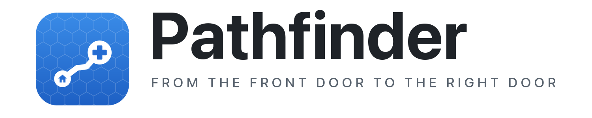
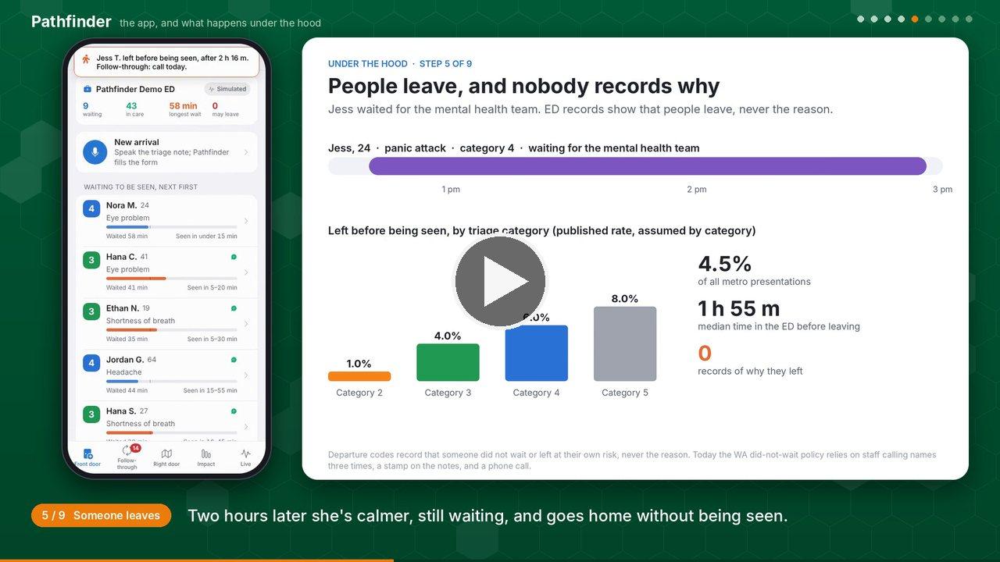
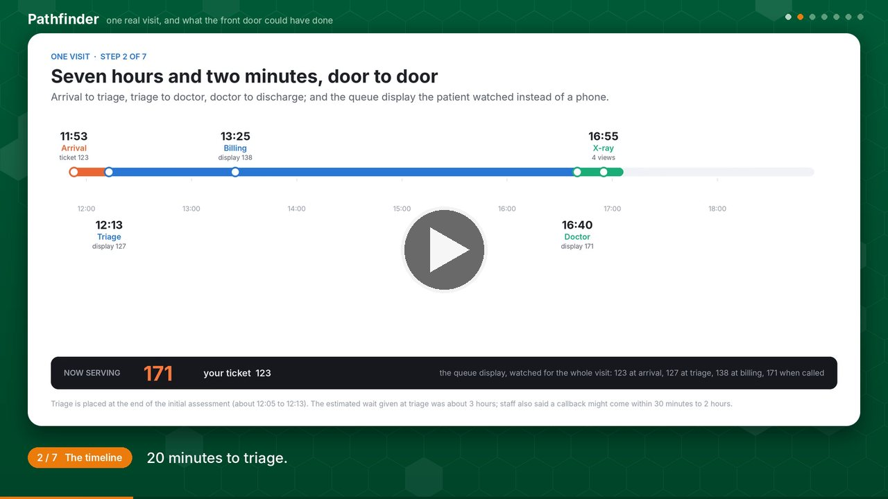
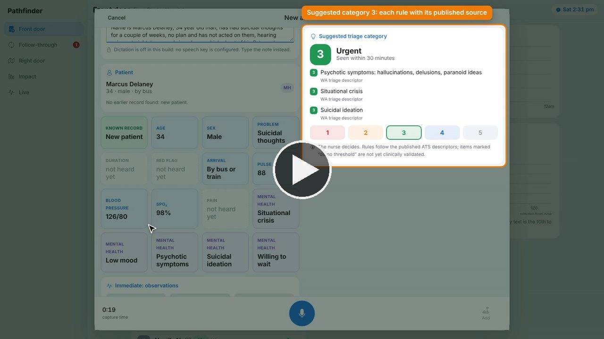

<p align="center">
  <picture>
    <source media="(prefers-color-scheme: dark)" srcset="docs/images/banner-dark.png">
    
  </picture>
</p>

<p align="center">
  <b>An open blueprint for the emergency department front door, and what happens after it.</b>
  The nurse speaks and the record builds itself. Everyone waiting gets an honest expected time by text. No one who
  leaves is lost, and next time the right service is found from home. This repository holds the working demo of one
  part of it: the screens and the models behind them, running entirely in your browser on a simulated department.
</p>

<p align="center">
  <a href="https://sapelkin.github.io/pathfinder-demo/"></a>
  <a href="https://wadsih.org.au/2026-wadsih-health-hackathon/"></a>
  <a href="#the-films"></a>
  <a href="LICENSE"></a>
  <br>
  <a href="#limits"></a>
  <a href="docs/PUBLIC_FIGURES.md"></a>
  <a href="web/engine"></a>
  <a href="web/app"></a>
</p>

> [!IMPORTANT]
> **A prototype for demonstration, not software for clinical use.** The emergency department, its patients, the text
> messages and the follow-up calls are simulated, and nothing connects to a hospital system. The triage rules follow
> published guidelines but have not been clinically validated. Every number comes from a published source or an
> assumption we state, listed in [PUBLIC_FIGURES.md](docs/PUBLIC_FIGURES.md); none comes from the hackathon's dataset.

## An honourable mention, and an open idea

Pathfinder received an honourable mention at the [2026 WADSIH Health Hackathon](https://wadsih.org.au/2026-wadsih-health-hackathon/)
in Perth, where we built it in one week for Challenge 2: alternative care pathways for mental health and for people
aged 65 and over.

We are publishing it so the idea can outlive the hackathon. Here are the problem in published numbers, the models
with their rules and sources, and a demo that runs them on a simulated department or on any of ten metropolitan WA EDs
rebuilt from WA Health's published numbers. If you work in an emergency department, a health service or a health-tech
company and want to take it further, you are welcome to.

## Try it

**[sapelkin.github.io/pathfinder-demo](https://sapelkin.github.io/pathfinder-demo/)**: no sign-in, no install, works on
a phone. The first load takes a few seconds while the Python engine starts in the browser.

- Tap the clock at the top right and choose **Guided demo** for the story in about 80 seconds.
- **New arrival** on the front door: type a triage note or insert one of eleven templates, and watch the record fill.
- **Settings → Hospital** switches Metro mode to any of ten metropolitan EDs; Fiona Stanley is the default.
- The last item of the clock menu, **Watch the demo video**, plays the screen recording full-page.

Your demo state stays in your browser (Settings → Your data to export, import or reset). There is no server and no
telemetry.

## The films

<table>
  <tr>
    <td width="33%" valign="top">
      <a href="https://sapelkin.github.io/pathfinder-demo/media/pathfinder_web_final_green.mp4"></a>
      <b>The film</b>, 104 s. A simulated Saturday afternoon in nine steps, from the nurse's first words to the right door
      for next time, with the models drawn as they run.
      <a href="media/pathfinder_web_final_green.mp4">File</a>
    </td>
    <td width="33%" valign="top">
      <a href="https://sapelkin.github.io/pathfinder-demo/media/pathfinder_case_elbow.mp4"></a>
      <b>One real visit</b>, 80 s. Seven hours in an ED with an injured elbow, told from the patient's own notes, and
      what the front door could have done at each gap.
      <a href="media/pathfinder_case_elbow.mp4">File</a>
    </td>
    <td width="33%" valign="top">
      <a href="https://sapelkin.github.io/pathfinder-demo/media/pathfinder_live_demo.mp4"></a>
      <b>The live demo</b>, 3 min 28 s, no sound. The website at Fiona Stanley Hospital, every feature highlighted as it
      is used.
      <a href="media/pathfinder_live_demo.mp4">File</a>
    </td>
  </tr>
</table>

## The problem

A visit to the emergency department has three moments where people fall through.

- **At the front door, nobody knows how long they will wait.** Public dashboards give an average of the past, not an
  expected time for the person in front of you.
- **Some give up, and nobody records why.** In 2023-24, 4.6% of people at Australia's public EDs left before being
  seen, up from 3.6% the year before (Report on Government Services 2026).
- **After the door, people come back.** In a New South Wales linkage study, 14.8% of people who did not wait were in an
  ED again within 7 days, and almost a quarter of those at a different hospital (Dinh et al., 2025). Studies of older
  adults put returns within 28 days at 8 to 18%.

## What Pathfinder does

1. **Know your wait.** The wait model runs this waiting room forward 100 times, with new arrivals, and texts everyone
   who consents the middle 80% of when they will be seen, refreshed every 10 minutes.
2. **The front door in under three minutes.** The nurse speaks; the record fills itself, a triage category is
   suggested with the published descriptor it matched, and the nurse decides.
3. **No one who leaves is lost, and everyone gets the right door.** One ranked follow-up list, a call script, and a
   search from the person's home, the way a ride-share app finds nearby drivers.

| Model | What it gives | How it works |
|---|---|---|
| Wait model | An expected wait as a range, for everyone waiting | A minute-step simulation of the room: Poisson arrivals from an hour-of-week template, calls by the largest share of each category's target already waited, lognormal patience. The 10th to 90th percentile across 100 futures goes out by text |
| Intake | The record without filling a form | A rule-based parser over the triage note: numbers spoken as words, clinical shorthand, voice commands. On the website you type the note or insert a template; dictation needs a speech service |
| Triage rules | A suggested category, with its source | A printable rule table from the ACEM triage guideline and WA's triage procedures; the most urgent match wins; the nurse decides |
| Follow-up ranker | Who to call first, and by when | The WA Country Health Service did-not-wait policy tiers, then a return-risk table by cohort, outcome and earlier visits |
| Right-door search | The right service for next time | Hexagon rings from home until enough services are found, then travel time by the person's own transport (Dijkstra), opening hours and a fit table |

## The website is one part, not the whole

Pathfinder is designed as units: 26 of them, of five kinds (connectors, stores, models, functions and screens), in
three layers. The foundation is seven units on one interface, the messages the ED system already sends, and it gives
everyone their wait without a new screen for staff. Each site adds a layer when it is ready.

This repository builds two kinds of unit and runs them for real: **the models** ([`web/engine`](web/engine)) and **the
screens** a nurse and a manager would use ([`web/app`](web/app)): the front door, follow-through, the right door, the
six measures and the live view. The connectors around them are simulated: the ED system's messages, the text
messages, the hospital record. The site's own Settings show the whole unit catalogue and which units each layer adds.

**Metro mode** puts the same models on a real department's load. WA Health publishes, for each metropolitan ED, how
many people are waiting, how many are in the department and the average wait for category 4. Pathfinder rebuilds that
room from those three numbers with Little's law, fills it with simulated patients, and measures what a redirect at
triage would change. At Fiona Stanley on the snapshot in this repository, a new category-4 arrival would wait about 45
minutes instead of 96. That is a simulation on published numbers, not a measurement.

## The numbers

The seed is built by [`web/engine/tools/build_public_seed.py`](web/engine/tools/build_public_seed.py) from published
WA and national figures (AIHW, the Report on Government Services, WA Health's public pages, the WA Auditor General,
published studies) and stated assumptions. It writes [`docs/PUBLIC_FIGURES.md`](docs/PUBLIC_FIGURES.md), a table of
every figure with its status and source, and calibrates the simulated waiting room to the published targets:

| Measure | Simulated | Target |
|---|---|---|
| Median wait to be seen | 38 min | 35 min: about twice the national median of 18 (AIHW 2024-25), as WA's published waits run |
| Did not wait | 4.4% | 4.5%: the national rate for 2023-24 on WA's triage mix |

Two parts of the wait model are calibrated, not measured: how fast the department calls people, and how long people
are willing to wait. Calibrating them on real visit-level data (arrival, triage, start of care and departure times)
is the first step to running Pathfinder at a real ED.

## Run it locally

You need Python 3.11+ and Node 22.

```bash
cd web/engine
pip install -e . pytest
pytest -m "not slow"
```

```bash
cd web/app
npm ci
npm run dev
```

Then open http://localhost:5173/. `npm run build:pages` builds the site exactly as GitHub Pages serves it, and the
workflow in [`.github/workflows/pages.yml`](.github/workflows/pages.yml) does that on every push to `main`.

## How the site works

The engine is plain Python with no dependencies. At build time it is packed into a wheel; in the browser,
[Pyodide](https://pyodide.org) runs it inside a Web Worker, and the React app calls its routes as if they were an API.
The whole department lives in that worker and is saved to your browser's storage after every action. Nothing is sent
anywhere. The same routes can also be served over HTTP (`VITE_API_MODE=http`), which is how a real deployment would
put a shared department behind sign-in.

## Repository map

```
.
├── LICENSE, NOTICE            Apache License 2.0, and the notices that go with it
├── web/
│   ├── engine/                the models and the simulated department (Python, standard library only)
│   │   ├── pathfinder_engine/ the package; data/ holds the seed and the WA Health snapshot
│   │   ├── tests/             87 tests, plus two slow calibration runs
│   │   └── tools/             the seed builder, the calibration, the snapshot fetcher
│   └── app/                   the website (React, TypeScript, Fluent UI, Vite)
│       ├── src/               screens, components, the engine worker
│       └── scripts/           build steps: Pyodide and the engine wheel, the films
├── media/                     the three films
├── docs/
│   ├── PUBLIC_FIGURES.md      every figure in the seed, published or assumed, with its source
│   └── images/                the banner and the film posters
└── .github/workflows/         build and deploy to GitHub Pages
```

## Limits

- **Nothing connects to a hospital.** The ED system's messages, the text messages, the follow-up calls and the
  hospital record are simulated.
- **The triage rules are not clinically validated.**
- **The demo ED, its patients, its queue and its geography are simulated.** Metro mode starts from published numbers
  for real hospitals, but everything after that is a simulation. Numbers on screen are not measurements.
- **The return-risk table is an assumption** anchored to published studies, not a measured rate.
- **The code is prototype code.** It was written quickly, largely with AI coding assistants, and it is checked only by
  the tests in this repository. It has not been reviewed for production or clinical use.

## Team

- **Eugenia Wulff Fuentes**: [LinkedIn](https://www.linkedin.com/in/eugenia-wulff-fuentes)
- **Ilya Sapelkin**: [LinkedIn](https://www.linkedin.com/in/sapelkin)
- **Nelson Betancourt**: [LinkedIn](https://www.linkedin.com/in/nelsonbetancourtp)

## Acknowledgements

- The organisers of the 2026 WADSIH Health Hackathon: WADSIH, Curtin University and the organising committee.
- The public sources listed in [PUBLIC_FIGURES.md](docs/PUBLIC_FIGURES.md), the ACEM Australasian Triage Scale
  guideline, and the WA Country Health Service policies the rules follow.
- WA Health's [Emergency department live activity](https://www.health.wa.gov.au/reports-and-publications/emergency-department-activity/data?report=ed_activity_now)
  page, the source of Metro mode's snapshot.
- [Pyodide](https://pyodide.org), which runs the engine in the browser.
- The films are narrated with Kokoro-82M (Apache 2.0), run locally.

## Licence

Apache License 2.0: see [LICENSE](LICENSE) and [NOTICE](NOTICE). The software is provided as is, without warranty of any
kind, and is not intended for clinical use.
